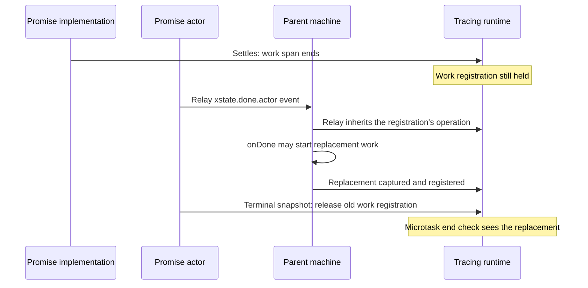

# Inspection and ordering

The runtime never replaces XState's mailbox, transition logic or relay. It
observes XState and wraps a few public methods. The inspection model and the
ordering guarantees on this page are those of XState v5.

| Surface              | Mechanism                                                        | Purpose                                                  |
| -------------------- | ---------------------------------------------------------------- | -------------------------------------------------------- |
| Inspection           | `tracing.inspect` on the root actor                              | Ownership of creations, sends, actions and snapshots     |
| Lifecycle checks     | One deferred read of the public snapshot per actor per macrostep | Failures and completions that inspection does not report |
| Root `stop()`        | A wrapper that calls the original                                | Stops before `start()`, which XState does not report     |
| Scheduler (optional) | Wrappers on the system scheduler and root clock                  | Identify which timer fired or was cancelled              |

Inspection callbacks for different actors can nest: a parent can flush a relay
that a child processes before the parent's own snapshot is reported.

## What each inspection event does

- **`@xstate.actor`** — Observe the actor, resolve its creating parent and
  record the operation that owns the parent's current processing. This happens
  before the child's initial state runs, so Promise work started during
  nested initialization joins the command.
- **`@xstate.event`** — Decide the event's owner, in this order: a pending
  command for this exact event and recipient; a firing timer's policy; the
  source's work registration; the operation that owns the source actor's
  current processing. Record a mirrored mailbox entry. A send to a terminal
  actor gets no entry.
- **`@xstate.action`** — Observe `stopChild` of a child that never started,
  and delayed `raise`/`sendTo` for timers.
- **`@xstate.microstep`** — Optional span event; never affects completion.
- **`@xstate.snapshot`** — Close the matching entry, release the work
  registrations of terminal Promise actors and clean up stopped actors.

## Mailbox ordering

Each actor processes its mailbox in order, while inspection reports events as
they arrive. The mirrored mailbox keeps ownership exact:

| Mailbox entry    | Owner while it is processed |
| ---------------- | --------------------------- |
| Traced command A | Operation A                 |
| Untraced event   | None                        |
| Traced command B | Operation B                 |

Matching by event type, or tracking only traced events, would let B claim the
untraced event's work.

## Commands before `start()`

| Step            | What happens                                                                   |
| --------------- | ------------------------------------------------------------------------------ |
| Create the root | Creation is inspected before the initial state is computed                     |
| Send A, then B  | Both are recorded with their own operations and queued by XState               |
| `start()`       | XState processes `xstate.init` first; the runtime processes init ahead of A    |
| Startup effects | No queued command owns them; nested children use their creating parent's owner |
| Mailbox drain   | A, then B, each owning only its own work                                       |

## Promise completion handoff

A successful Promise actor settles, then XState relays its done notification
to its parent: the
[completion handoff](../reference/glossary.md#library-terms).

A rejection follows the same path with an error event. Some error paths have
no terminal snapshot, so work registration cleanup is deferred to a microtask
after the error relay.

## Errors without subscriptions

Subscribing to an actor's errors changes whether XState treats them as
handled, so the runtime never subscribes. Instead:

- After each inspected send it schedules one coalesced read of the
  actor's public snapshot, tracked in weak sets so finished actors are not
  retained.
- Before a relay from a source that has failed or completed reaches the
  parent, it reconciles the source from its public snapshot. Child failures
  are therefore accounted for before the parent's handler starts replacement
  work.
- During snapshot inspection it reads the current public snapshot, because
  startup effects can fail after the inspected snapshot was taken.
- Errors thrown while constructing an actor are reported only once the actor
  actually starts, and a stop right after a failure records the failure
  first.

XState, the application's observers and parent handlers stay authoritative.
The runtime adds no throw and no console output; see
[native reporting](../reference/outcomes.md#actor-failures-and-native-reporting).

## Stops

| Path                     | How the runtime notices                                      |
| ------------------------ | ------------------------------------------------------------ |
| Running actor stops      | `xstate.stop` inspection, even if the snapshot says `active` |
| Root stops before start  | The `stop()` wrapper, after the original returns             |
| Child stops before start | The `stopChild` action inspection                            |
| Actor completes          | Its terminal snapshot, with cleanup after the parent relay   |
