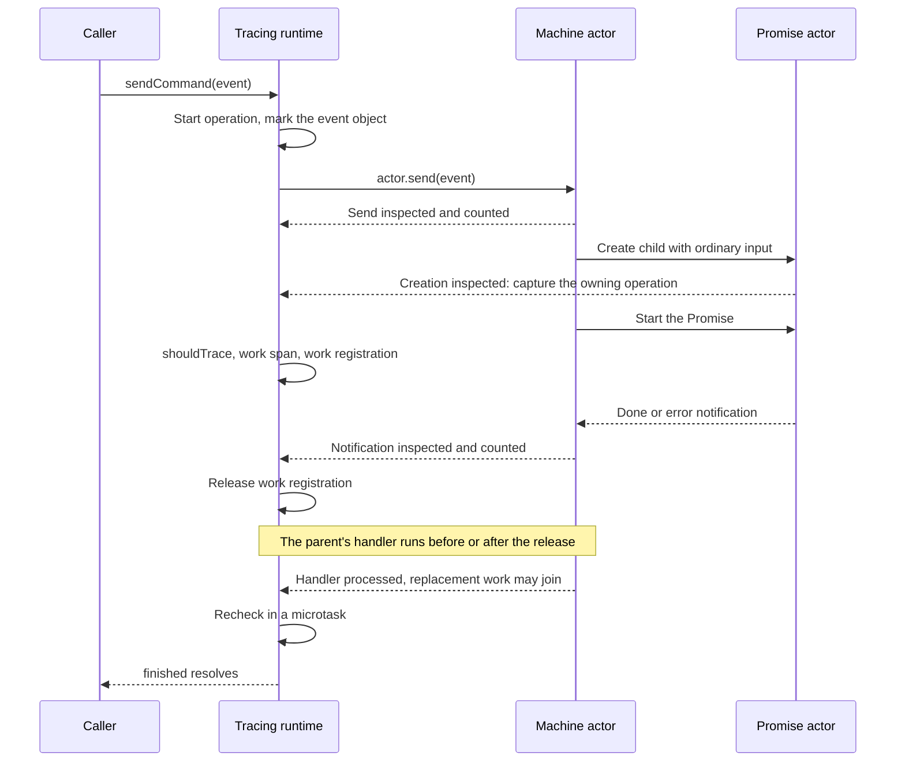

# Model and operation lifecycle

This page explains how one command becomes one operation and why it ends when
it does. The [introduction](../guide/introduction.md) covers why operations
are per command rather than per actor.

## The operation record

Each operation holds its span and context, a **pending event count** of the
events it owns that are waiting or being processed, and the
[work registrations](../reference/glossary.md#library-terms) of its traced
Promise actors. The operation ends when both are empty.

## 1. Start

`sendCommand` creates the span and remembers the exact event object together
with the target actor, then calls `actor.send`. The first matching
`@xstate.event` inspection claims the operation, so the same event object can
be sent several times without confusion. The runtime always calls `send`,
even for a terminal target. When the send is not counted, the operation ends
with an outcome and reason from [outcomes](../reference/outcomes.md). If
`send` throws, the runtime removes that operation's mirrored mailbox
entries, finishes it `failed` and rethrows.

## 2. Count every event

Inspection reports an event before the actor processes it, and an actor that
is already busy queues it. The runtime therefore mirrors each actor's mailbox,
including untraced events, and matches each snapshot to the entry it closes.
Entries owned by the operation increment and decrement its pending event
count.

Untraced events have to be mirrored too. If a traced command A, an untraced
event and a traced command B are queued in that order, skipping the middle
entry would make B the owner of the untraced event's work. The
[ordering page](inspection-and-ordering.md#mailbox-ordering) shows this case
and commands queued before `start()`.

A [relay](../reference/glossary.md#library-terms) inherits ownership from its
source: the operation that owns the event the source actor is processing, or
the work registration of a traced Promise actor whose done or error
notification is being relayed.

## 3. Attach Promise work

Ownership of Promise work follows actor creation, not input:

- When a child actor is created, the runtime records the operation that owns
  the creating parent's current processing, keyed by the child actor.
- When a `tracing.fromPromise` starts, it joins that recorded operation. It never
  looks for a newer one. `shouldTrace` decides only whether to trace this
  child, and runs at start, after ownership was captured.
- Inputs carry no markers and are never inspected, copied or wrapped.
- A child created with no live operation runs untraced, and a child that
  starts after its operation ended cannot reopen it.

The recorded owner is cleared on initialization, stop, error or when the
operation ends, so a retained child that never starts does not retain an
ended operation.

## 4. End in the right order

The work span ends as soon as the Promise settles. The work registration
lasts through the [completion handoff](../reference/glossary.md#library-terms), so a replacement Promise started
by `onDone` or `onError` joins before the operation can end.

When the pending event count and the work registrations both reach zero, the
runtime checks again in a microtask before ending the operation. This gives a busy parent's
queued completion event or a synchronous handoff the chance to register new
work, without depending on state names. It does not wait for timers or
anything asynchronous.

## Why outcomes mean what they mean

A relay to an already terminal actor can happen after the command has taken
effect. Marking the operation `cancelled` for that relay could prompt a caller
to repeat the command. Distinguishing a target failure from a handled child
error lets callers tell whether the target itself failed. See
[Outcomes](../reference/outcomes.md) for how each case is recorded.

## Keeping business data clean

Associations live in private weak maps keyed by actors and event objects.
Nothing is added to machine context, events or inputs, so snapshots can be
persisted without telemetry. Weak keys do not make their values collectable,
so every record is also removed explicitly when its event, child or
operation finishes; see [performance](performance.md).
