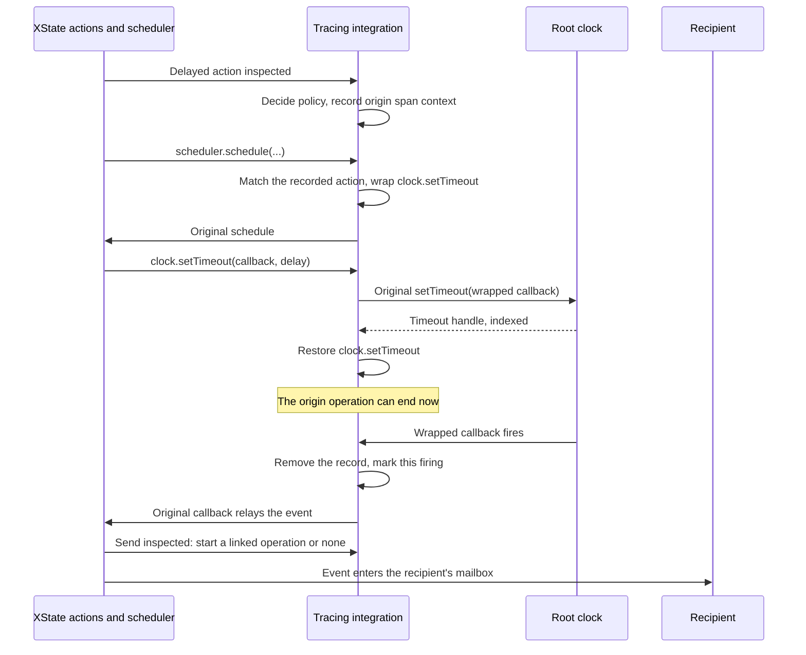

# Scheduler internals

This page describes the optional integration that
[timer policy](../guide/scheduled-work.md) installs. Without
`timerPolicy`, none of it exists: no wrappers and no timer records.

## How XState schedules delayed work

- A delayed `raise` calls `system.scheduler.schedule(self, self, event, delay, id)`.
- A delayed `sendTo` resolves its recipient, event and delay, then calls
  `schedule(source, target, ...)`.
- `after` is generated delayed raises on entry, with matching cancellations on
  exit, so it uses the same path.
- The scheduler uses the **root** actor's clock, even when a child has its own.

Even an `untraced` policy installs the integration, so a firing timer is
never mistaken for an immediate relay from whatever actor is running.

## Registration and firing



The delayed action is matched to its registration by source, exact event
object, recipient, delay and ID. Each registration gets its own callback, so a
reused event object cannot merge two timers, and the event is never cloned or
tagged. The firing marker is consumed when the send is inspected, before
the recipient runs, so follow-up relays use ordinary ownership.

A timer record keeps only the origin's span context, its operation ID and the
copied policy, never the origin's live span. This is why timers cannot hold an
operation open or retain it after it ended.

## Cancellation and duplicate IDs

The wrapped `cancel` lets XState resolve its own cancellation slot and briefly
wraps `clock.clearTimeout` to learn which handle XState actually clears. Only
that record is removed. `cancelAll` is not wrapped: XState's `cancelAll` calls
`cancel` for each of the actor's timers, so it goes through the same path.
Stopping or failing an actor discards all its remaining records.

XState keys cancellation by source and ID. Scheduling a second timer with the
same ID replaces the slot without cancelling the first, so cancelling the ID
reaches only the newer timer, and an older timer firing can clear the slot
while the newer one is still pending. The integration preserves this
behaviour instead of repairing it. Use distinct IDs for timers that can
overlap.

## Requirements

On the first actor creation, before any wrapper is installed or any actor
state is computed, the integration checks the four methods it wraps:

```text
system.scheduler: schedule, cancel
root actor clock: setTimeout, clearTimeout
```

Each must be a writable function-valued data property. An inherited method
needs an extensible receiver so it can be shadowed; an own writable method
works even on a sealed object. Accessors, missing methods and frozen objects
fail the check: the `scheduler` diagnostic is reported and `createActor`
throws a `TypeError`. There is no silent fallback, because an unmarked timer
could borrow an unrelated operation.

The checks cannot prove that a custom clock behaves correctly. It must also
register callbacks synchronously, fire them only after registration returns
and return a distinct handle for each live timer. XState's stock clock and
`SimulatedClock` meet this contract. Do not replace the wrapped methods or
freeze their objects after setup; a later wrapping failure is reported and
thrown.
