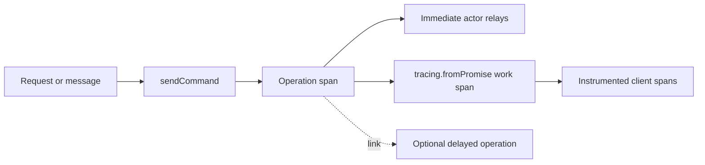

# Introduction

`@actorium/xstate-otel` traces XState v5 actor systems with OpenTelemetry. It
is built for actors that live for hours or days and handle many separate
commands: an order, a checkout, a device session.

## Commands, not actors, define spans

Representing a long-lived actor as one span would mix unrelated work into one
trace and leave a span open for days. Instead, each externally meaningful
command starts a bounded **operation**:

The operation stays open while the command's events are being processed
and while finite Promise work it started is running. When the actor reaches a
waiting state with nothing left to do, the operation ends. The next command,
such as an approval or a retry, starts a new trace. No state names are
involved; see [the model](../explanation/model.md).

## What is traced

| Traced automatically                                                                   | Needs an explicit boundary                                      |
| -------------------------------------------------------------------------------------- | --------------------------------------------------------------- |
| Commands sent with [`sendCommand`](commands.md)                                        | Plain `actor.send` from outside the actor system                |
| `sendTo`/`sendParent` relays made while handling a traced command                      | Callbacks, subscriptions and messages after the macrostep ended |
| [`tracing.fromPromise`](promise-work.md) actors created while processing traced events | The inner steps of callback, observable and stream actors       |
| Client calls inside a traced Promise, with host instrumentation                        | Timers, unless you set a [timer policy](scheduled-work.md)      |
| Microsteps as span events, when enabled                                                | Business success or failure                                     |

## Who owns what

The application owns the OpenTelemetry SDK, context manager, sampling,
exporters and shutdown. It decides which messages are commands, names
operations, chooses which Promise work to trace and handles business errors.

The library observes XState inspection events, associates events and
Promise actors with operations, creates and ends spans and reports each
command's [outcome](../reference/outcomes.md). It keeps trace context out of
machine context, events and inputs, so persisted workflow state never contains
telemetry.

`OperationTrace.finished` reports when the traced work settled. It is not a
business result: read the actor's snapshot or an application reply for that.

Next: [get started](getting-started.md).
